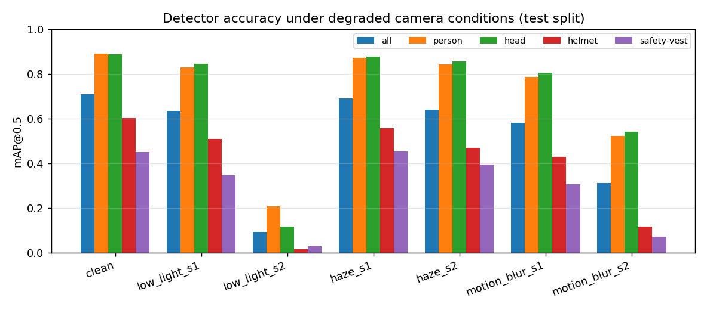
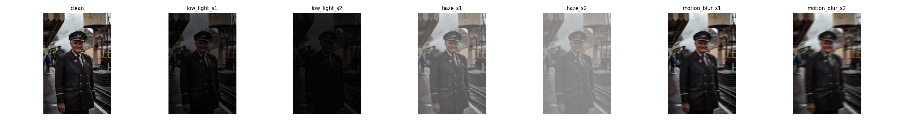

# PPE Detector for Industrial Workers, and How It Fails on Plant Cameras

Fine-tunes a pretrained **YOLO11n** detector to find **people, heads, helmets and safety vests** in industrial scenes. Then it measures how much accuracy is lost under conditions real plant cameras face: **low light, smoke/haze and motion blur**.

> **Question:** a PPE detector that scores well on clean photos can still fail on dark, dusty factory feeds. How big is that drop, and which classes suffer most?




## Results

Trained on a Kaggle T4 GPU (50 epochs, about 2.8 ms per image inference).

**Held-out test set** (1,620 images, never used for training or model selection):

| class | test instances | precision | recall | mAP50 | mAP50-95 |
|---|---|---|---|---|---|
| **all** | 5,412 | 0.751 | 0.674 | **0.715** | 0.502 |
| person | 2,734 | 0.882 | 0.833 | 0.888 | 0.697 |
| head | 2,427 | 0.931 | 0.849 | 0.888 | 0.663 |
| helmet | 154 | 0.608 | 0.554 | 0.618 | 0.379 |
| safety-vest | 97 | 0.583 | 0.461 | 0.464 | 0.268 |

For reference, the SH17 paper reports about 70.9% mAP50 for its largest model (YOLOv9-e) on all 17 classes. That's not directly comparable: this model is far smaller (YOLO11n) and uses only 4 classes.

**Robustness** (mAP50 on the same test images, resized to 640 px then degraded):

| condition | all | drop vs clean | person | head | helmet | safety-vest |
|---|---|---|---|---|---|---|
| clean | 0.707 | – | 0.889 | 0.887 | 0.601 | 0.450 |
| low light, moderate | 0.632 | −10.6% | 0.829 | 0.844 | 0.508 | 0.347 |
| low light, severe | 0.092 | **−87.1%** | 0.206 | 0.117 | 0.016 | 0.028 |
| haze, moderate | 0.688 | −2.6% | 0.870 | 0.875 | 0.555 | 0.452 |
| haze, severe | 0.640 | −9.5% | 0.841 | 0.854 | 0.468 | 0.395 |
| motion blur, moderate | 0.581 | −17.8% | 0.786 | 0.805 | 0.427 | 0.306 |
| motion blur, severe | 0.312 | −55.9% | 0.521 | 0.541 | 0.115 | 0.070 |

The clean row (0.707) differs slightly from the test table (0.715) because these images are pre-resized to 640 px before degrading.

**Takeaways**
- **Low light is a cliff, not a slope.** At 35% brightness the model loses about 11%; at 15% brightness plus sensor noise it collapses (−87%). Night shifts and dim bays need IR cameras, better lighting, or low-light training augmentation; this model can't just be "a bit worse" in the dark.
- **Haze is the least harmful.** Even severe haze costs under 10%. Contrast loss hurts less than lost brightness or blurred edges.
- **PPE classes are the most fragile, and the rarest.** Under every degradation, helmet and vest accuracy fall much faster than person and head accuracy (severe blur: helmet −81% vs person −41%). They're also 15–25× rarer in the data (154 helmets and 97 vests vs ~2,500 people and heads in the test set). Collecting more PPE examples, or oversampling them, is the most direct fix.
- **"Head" means any head.** In SH17, 81% of labelled helmets sit on a labelled `head` box, so "no helmet" has to be inferred as *a head with no helmet on it*. Since helmet recall is only 0.55, missed helmets become false "no helmet" alerts downstream (see Project 2).
- **Training hadn't fully plateaued.** Validation mAP was still rising slightly at epoch 50 ([curves](results/training/results.png)), so a longer schedule or a bigger model (YOLO11s) would likely gain a few points.

**Failure gallery:** not generated in the Kaggle run, and the cause isn't confirmed yet. The notebook now stops on any failed step instead of continuing silently. To produce it, run `failure_gallery.py` again where the test images are available (Kaggle/Colab).

## Method

| Step | Details |
|---|---|
| Data | [SH17](https://github.com/ahmadmughees/SH17dataset): 8,099 manufacturing images (CC BY-NC-SA 4.0). Kept 4 of 17 classes: `person`, `head`, `helmet`, `safety-vest`. `head` covers *every* head (81% of helmets sit on a labelled head), so "no helmet" = a head with no helmet detected on it |
| Splits | Official train list → 90% train / 10% val (seeded). Official val list → **held-out test** |
| Preprocessing | Images downscaled to a 1280 px long side (originals reach 8192 px). This cuts disk use and load time without affecting 640 px training |
| Model | YOLO11n (2.6 M params), COCO-pretrained, fine-tuned 50 epochs at 640 px, early stopping (patience 15), seed 0 |
| Robustness | The test set is resized to 640 px, then degraded at two severities: **low light** (brightness ×0.35 / ×0.15 + sensor noise), **haze** (scattering model `I = J·t + A·(1−t)`, t = 0.55 / 0.3), **motion blur** (9 / 21 px kernel at a random angle). Fixed seeds, so it's reproducible |
| Error analysis | Predictions matched to ground truth per class at IoU ≥ 0.5. Misses broken down by object size (small < 1% of image area, medium < 5%, large) |

## Run it

**Train on a free GPU (recommended):** open `colab_train.ipynb` in Google Colab (T4 GPU) or Kaggle (GPU + the SH17 dataset attached as input) and run all cells (about 1.5–2 h). It downloads SH17, trains, evaluates, runs the robustness test and the failure gallery, then zips `results/` and `weights/` for download.

**Locally** (a CPU is enough for a smoke test, not for real training):
```bash
pip install -r requirements.txt
python -m pytest -q tests                               # unit tests
python download_sh17.py --out data/sh17_raw --limit 40  # small sample, no Kaggle account needed
python prepare_data.py --raw data/sh17_raw --out data/sh17_ppe
python train.py --data data/sh17_ppe/sh17_ppe.yaml --epochs 1 --imgsz 320 --device cpu --out weights/smoke.pt
python evaluate.py      --weights weights/smoke.pt --data data/sh17_ppe/sh17_ppe.yaml --imgsz 320
python robustness.py    --weights weights/smoke.pt --data data/sh17_ppe/sh17_ppe.yaml --imgsz 320
python failure_gallery.py --weights weights/smoke.pt --data data/sh17_ppe/sh17_ppe.yaml --imgsz 320
```

## Files

| File | Purpose |
|---|---|
| `download_sh17.py` | Fetch SH17 files from Kaggle (a sample, or everything) |
| `prepare_data.py` | Filter to 4 classes, remap IDs, split, resize, write `sh17_ppe.yaml` |
| `train.py` | Fine-tune YOLO11n and copy the best weights to `weights/` |
| `evaluate.py` | Per-class precision/recall/mAP on the test split → `results/test_metrics.*` |
| `degrade.py` | Low-light / haze / motion-blur functions |
| `robustness.py` | Evaluate under each degradation → table, chart, example strip |
| `failure_gallery.py` | Worst/best predictions drawn, plus misses by object size |
| `colab_train.ipynb` | The whole pipeline on a Colab GPU |
| `tests/` | Unit tests for label remapping, splitting, degradations, box matching |

## Limitations

- SH17 is stock photography of workers, not CCTV. It's clearer and closer-up than real plant footage, so these numbers are optimistic for a real deployment.
- The degradations are synthetic approximations, not real smoke or IR footage.
- Helmet detection only checks whether something helmet-like is on the head. It can't tell whether a hard hat is the correct rated type, or whether the chin strap is fastened.
- SH17 is licensed CC BY-NC-SA 4.0 (non-commercial) and Ultralytics is AGPL-3.0. Both are fine for a portfolio, but not for a commercial product as-is.

## Used by

`../02-danger-zone-alert` uses `weights/ppe_yolo11n.pt` to flag workers without helmets in a video.
