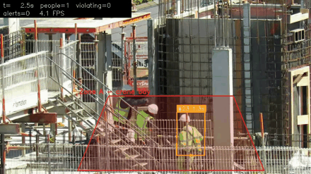

# Danger-Zone & Helmet Alerts from a Fixed Camera

Watches a camera feed and raises an alert, tied to a specific SOP clause, when a worker:
- **stays inside a danger zone** (e.g. a crane bay) longer than allowed, or
- is **not wearing a helmet**.

Each alert produces a snapshot and a CSV log line (`time, worker ID, rule, zone, SOP clause, reason`), plus an annotated video. It reuses the PPE detector trained in [`../01-ppe-detector`](../01-ppe-detector).



*Worker #23 stays in the crane-bay zone past the 3 s limit and turns red. Source video: "Building construction Moira Close Broadwater Farm Haringey 2025 13", Wikimedia Commons, [CC BY-SA 4.0](https://creativecommons.org/licenses/by-sa/4.0/); annotations added. This GIF is shared under the same licence.*

## How it works

```
video / RTSP ─► YOLO detector (person, head, helmet)      ─► ByteTrack (stable worker IDs)
                                                                   │
                       ┌───────────────────────────────────────────┤
                       ▼                                           ▼
     zone rule: foot point inside polygon?            helmet rule: head with no helmet on it
     dwell timer per worker > limit?                  inside the person's head region?
                       │                              confirmed in k of last n frames?
                       └──────────────┬────────────────────────────┘
                                      ▼
                  cooldown per worker+rule ─► alert: snapshot + events.csv + console
```

## Design decisions (and why)

| Decision | Why |
|---|---|
| **Zone test uses the person's feet** (bottom-centre of the box), not the box centre | From an elevated camera, a person's box centre can lie over a floor zone while they're standing outside it |
| **Dwell time limit**, not instant alerts | Walking past a zone edge isn't a violation. Staying in a crane bay is |
| **Exit grace period** (0.5 s) | A box flickering across the zone edge, or briefly lost, shouldn't reset the timer. Only being *seen outside* for longer does |
| **Helmet status has three states**: helmet / head with no helmet / *unknown* | Back turned, head occluded or too far away means "can't tell", which must not become an alert, or supervisors drown in false alarms |
| **Asymmetric confidence**: persons and heads need ≥ 0.35, helmets only ≥ 0.15 | The `head` class covers every head, so "no helmet" really means "no helmet detected". A missed helmet becomes a false alarm, while a weakly detected one costs nothing. On the test clip this cut false no-helmet alerts from 9 to 5 |
| **k-of-n confirmation** (default 8 of 12 frames) | A single-frame "no helmet" misdetection doesn't trigger anything. `--no-filter` turns it off so the effect can be measured |
| **Cooldown** per worker per rule | One incident = one alert, not 30 per second |
| **Rules in `config.yaml`, each citing an SOP clause** | Safety teams can change zones and limits without touching code, and every alert is traceable to a procedure |
| **Zone polygons in 0–1 coordinates** | The same config works if the stream resolution changes |
| **Rule logic in `rules.py` with no CV dependencies** | It's fully unit-tested (16 tests) without a GPU or video |

## Results

**Test clip** (15 s, 854×480, construction site, a hand-held camera rather than real CCTV), with the Project 1 model:

| setting | zone-dwell alerts | "no helmet" alerts |
|---|---|---|
| helmet threshold = person threshold (0.35) | 4 | 9 |
| **asymmetric helmet threshold (0.15)**, the default | 2 | **5** |

In the frames checked, every worker in this clip wears a hard hat, so **all "no helmet" alerts here are false alarms**. Lowering the helmet threshold removed about half of them; the rest come from missed helmets (Project 1 helmet recall is only 0.55) and from merged boxes, where two crouching workers are detected as one person. Zone-dwell counts also changed, because the tracker now receives extra low-confidence detections. Without ground truth for this clip, it's not yet measured whether that's better or worse; recording a labelled clip (below) is the next step.

**Speed:** on a 2015 dual-core laptop CPU, ≈4 FPS (≈240 ms detect+track, ≈12 ms rules, drawing and I/O per frame). Detection dominates, so a GPU or an exported ONNX/OpenVINO model is where speed-ups come from, not the rule logic.

**Failure modes seen:**
- **Missed helmets → false "no helmet" alerts.** This is the main weakness, and it comes straight from the detector's helmet recall. Fixes: more helmet training data, higher input resolution for distant workers, or tracking helmet status per worker over a longer window.
- **Workers behind mesh fencing or crouching** were detected unreliably, and two close workers sometimes merged into one person box.
- **Track ID switches** restart the dwell timer (with the stock COCO model one worker went #3 → #10 and never reached the limit). Handling this properly needs re-identification, or zone-level occupancy timing instead of per-ID timing.

## Run it

```bash
pip install -r requirements.txt
python -m pytest -q tests

# 1. draw the danger zone on your video and paste the polygon into config.yaml
python pick_zone.py --source videos/my_clip.mp4

# 2. run (uses ../01-ppe-detector/weights/ppe_yolo11n.pt by default)
python zone_alert.py --source videos/my_clip.mp4            # add --show for a live window
python zone_alert.py --source videos/my_clip.mp4 --no-filter  # same, without k-of-n smoothing

# person-only test with the stock COCO model (helmet rule switches itself off)
python zone_alert.py --source videos/my_clip.mp4 --weights yolo11n.pt

# 3. GIF for this README
python make_gif.py --video output/my_clip/annotated.mp4 --start 2 --seconds 6
```

Outputs go to `output/<clip name>/`: `annotated.mp4`, `events.csv`, `snapshots/`.

## Measure it

1. **Record a 1–2 minute clip** with a phone on a tripod (it must not move, like a CCTV camera). Act out several incidents: walk through the zone quickly (should *not* alert), stand in it for 5+ s (should alert), take a helmet off for 10 s (should alert), turn your back with no helmet (ideally *no* alert).
2. **Write the ground truth** in `videos/my_clip_gt.csv`:
   ```
   rule,start_s,end_s,note
   zone_dwell,12.0,19.5,stands in crane bay
   no_helmet,31.0,40.0,helmet removed
   ```
3. **Score both runs:**
   ```bash
   python evaluate_events.py --pred output/my_clip/events.csv          --gt videos/my_clip_gt.csv
   python evaluate_events.py --pred output/my_clip_nofilter/events.csv --gt videos/my_clip_gt.csv
   ```
   The difference in false alarms between the two runs is the measured value of the k-of-n filter.

## Files

| File | Purpose |
|---|---|
| `zone_alert.py` | Main loop: read video → detect+track → rules → draw → log |
| `rules.py` | Point-in-polygon, foot point, helmet association, dwell timer, k-of-n, cooldown |
| `config.yaml` | Model, class→role mapping, zones, SOP text, thresholds |
| `pick_zone.py` | Click to draw a zone polygon on a frame |
| `evaluate_events.py` | Precision/recall of alerts vs. hand-labelled incidents |
| `make_gif.py` | GIF from the annotated video for the README |
| `tests/` | Unit tests for rules and scoring |

## Limitations and next steps

- Per-ID dwell timing breaks on tracker ID switches. Next step: re-identification, or "zone occupied for N s" timing.
- A single camera and a 2D zone can't judge height: a worker on a ladder above the zone counts as inside it.
- Helmet association is geometric (a helmet centre in the top 30% of the person box). Crowded scenes with overlapping people can attach a helmet to the wrong worker.
- Not tested on real CCTV, IR or night footage. See Project 1's robustness study for how detection degrades.
