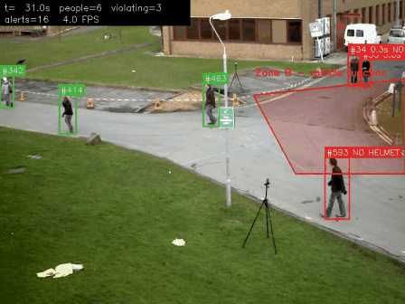

# Danger-Zone & Helmet Alerts from a Fixed Camera

Watches a camera feed and raises an alert, tied to a specific SOP clause, when a worker:
- **stays inside a danger zone** (e.g. a crane bay) longer than allowed, or
- is **not wearing a helmet**.

Each alert produces a snapshot and a CSV log line (`time, worker ID, rule, zone, SOP clause, reason`), plus an annotated video. It reuses the PPE detector trained in [`../01-ppe-detector`](../01-ppe-detector).


*Worker #23 stays in the crane-bay zone past the 3 s limit and turns red. Source video: "Building construction Moira Close Broadwater Farm Haringey 2025 13", Wikimedia Commons, [CC BY-SA 4.0](https://creativecommons.org/licenses/by-sa/4.0/); annotations added. This GIF is shared under the same licence.*

## How it works

```
video / RTSP ─► YOLO detector (person, head, helmet)      ─► ByteTrack (stable worker IDs)
                                                                   │
                       ┌───────────────────────────────────────────┤
                       ▼                                           ▼
     zone rule: foot point inside polygon?            helmet rule: head with no helmet on it
     dwell timer per worker > limit?                  inside the person's head region?
                       │                              confirmed in k of last n frames?
                       └──────────────┬────────────────────────────┘
                                      ▼
                  cooldown per worker+rule ─► alert: snapshot + events.csv + console
```

## Design decisions (and why)

| Decision | Why |
|---|---|
| **Zone test uses the person's feet** (bottom-centre of the box), not the box centre | From an elevated camera, a person's box centre can lie over a floor zone while they're standing outside it |
| **Dwell time limit**, not instant alerts | Walking past a zone edge isn't a violation. Staying in a crane bay is |
| **Exit grace period** (0.5 s) | A box flickering across the zone edge, or briefly lost, shouldn't reset the timer. Only being *seen outside* for longer does |
| **Helmet status has three states**: helmet / head with no helmet / *unknown* | Back turned, head occluded or too far away means "can't tell", which must not become an alert, or supervisors drown in false alarms |
| **Asymmetric confidence**: persons and heads need ≥ 0.35, helmets only ≥ 0.15 | The `head` class covers every head, so "no helmet" really means "no helmet detected". A missed helmet becomes a false alarm, while a weakly detected one costs nothing. On the test clip this cut false no-helmet alerts from 9 to 5 |
| **k-of-n confirmation** (default 8 of 12 frames) | A single-frame "no helmet" misdetection doesn't trigger anything. `--no-filter` turns it off so the effect can be measured |
| **Cooldown** per worker per rule | One incident = one alert, not 30 per second |
| **Rules in `config.yaml`, each citing an SOP clause** | Safety teams can change zones and limits without touching code, and every alert is traceable to a procedure |
| **Zone polygons in 0–1 coordinates** | The same config works if the stream resolution changes |
| **Rule logic in `rules.py` with no CV dependencies** | It's fully unit-tested (21 tests, with the evaluators) without a GPU or video |

## Results

### Benchmark: measured precision and recall on CCTV-style footage

**PETS09-S2L1** is a standard surveillance benchmark: a fixed, elevated camera, 795 frames (113 s at 7 fps, 768×576). Every person in every frame is annotated by hand. I drew a danger zone on the road junction (`config_pets09.yaml`, 5 s limit). [`evaluate_mot.py`](evaluate_mot.py) then **computes the true incidents from the annotations**, using the same polygon, foot-point test, dwell limit and exit grace as the alert system. It finds 11 real incidents, plus 14 shorter stays that must *not* alert. An alert only counts if its box overlaps the right annotated person (IoU ≥ 0.3) within 1 s of the incident.



*Two people stay in the junction past 5 s and turn red. Source: PETS 2009 S2L1 via [MOTChallenge](https://motchallenge.net/), CC BY-NC-SA 3.0; annotations added. This GIF is shared under the same licence.*

| detector | alerts | correct | repeats | false alarms | missed | **precision** | **recall** | IDs per person |
|---|---|---|---|---|---|---|---|---|
| Project 1 PPE model (YOLO11n, SH17) | 15 | 10 | 3 | 2 | 1 | **0.87** | **0.91** | 3.3 |
| Stock COCO YOLO11n (person only, no helmet rule) | 14 | 10 | 2 | 2 | 1 | 0.86 | 0.91 | 2.6 |

*Repeats are extra alerts on an incident already caught (a reminder after the 15 s cooldown, or the same person under a new tracker ID). They are correct, but redundant. "IDs per person" is how many tracker IDs each annotated person received; 1.0 would mean no identity switches.*

**What the three errors were** (all on the same person, who stays around the junction for over a minute):
- **Missed, because of an ID switch.** The person stood in the zone for 9.5 s, but the tracker lost them after 4.1 s and gave them a new ID, which restarted the timer. They left at 4.7 s without an alert.
- **False alarm, because of an ID swap.** Two people crossed paths and the tracker moved one person's ID (with 4.7 s of accumulated dwell time) onto the other, who had just stepped in.
- **False alarm, borderline.** The annotation of this person begins when they're already inside the zone, giving 4.7 s against a 5 s limit. The detector picked them up 0.6 s earlier and counted 5.1 s.

**Takeaway: detection is good enough here; identity tracking is the bottleneck.** Two of the three errors come from tracker identity mistakes, not missed detections, and the stock COCO detector makes exactly the same three errors. (The PPE model run has more ID switches, 3.3 vs 2.6 IDs per person. One likely cause, not yet tested, is that it also feeds head and helmet boxes into the tracker.) The fix is to time *zone occupancy* (someone has been in the zone for N s, whoever it is), or add appearance re-identification, rather than a better detector.

**Exit grace (0.5 s vs 0): no difference on this footage.** Results were identical, because boxes here never flicker across the zone edge. The grace period is a safeguard for noisier cameras, not something this benchmark exercises.

**Helmet rule:** nobody in PETS09 wears a hard hat, so this measures coverage, not false alarms. 16 of the 19 bareheaded people received a "no helmet" alert, and every alert was on a real person. Only 1 of ~4,500 person-frames was wrongly marked "helmet". Helmet status was "unknown" in 56% of person-frames: at this distance (people ~75 px tall) heads are often too small to judge, and the rule correctly stays silent instead of guessing.

Reproduce:
```bash
python zone_alert.py --source videos/pets09/PETS09-S2L1-raw.mp4 --config config_pets09.yaml --out output/pets09_ppe
python evaluate_mot.py --gt videos/pets09/gt.txt --video videos/pets09/PETS09-S2L1-raw.mp4 \
    --config config_pets09.yaml --pred output/pets09_ppe --nobody-wears-helmets
```
The video is `PETS09-S2L1-raw.mp4` from motchallenge.net/sequenceVideos/, and `gt.txt` comes from `MOT15Labels.zip` (train/PETS09-S2L1).

### Construction-site clip: a qualitative check of the helmet rule

**Test clip** (15 s, 854×480, construction site, a hand-held camera rather than real CCTV), with the Project 1 model:

| setting | zone-dwell alerts | "no helmet" alerts |
|---|---|---|
| helmet threshold = person threshold (0.35) | 4 | 9 |
| **asymmetric helmet threshold (0.15)**, the default | 2 | **5** |

In the frames checked, every worker in this clip wears a hard hat, so **all "no helmet" alerts here are false alarms**. Lowering the helmet threshold removed about half of them; the rest come from missed helmets (Project 1 helmet recall is only 0.55) and from merged boxes, where two crouching workers are detected as one person. Zone-dwell counts also changed, because the tracker now receives extra low-confidence detections. This clip has no ground truth; the zone rule's measured accuracy is the PETS09 benchmark above.

**Speed:** on a 2015 dual-core laptop CPU, ≈4 FPS (≈240 ms detect+track, ≈12 ms rules, drawing and I/O per frame). Detection dominates, so a GPU or an exported ONNX/OpenVINO model is where speed-ups come from, not the rule logic.

**Failure modes seen:**
- **Missed helmets → false "no helmet" alerts.** This is the main weakness, and it comes straight from the detector's helmet recall. Fixes: more helmet training data, higher input resolution for distant workers, or tracking helmet status per worker over a longer window.
- **Workers behind mesh fencing or crouching** were detected unreliably, and two close workers sometimes merged into one person box.
- **Track ID switches** restart the dwell timer, or carry one person's time over to another. On PETS09 they caused 2 of the 3 zone errors. Handling this properly needs re-identification, or zone-level occupancy timing instead of per-ID timing.

## Run it

```bash
pip install -r requirements.txt
python -m pytest -q tests

# 1. draw the danger zone on your video and paste the polygon into config.yaml
python pick_zone.py --source videos/my_clip.mp4

# 2. run (uses ../01-ppe-detector/weights/ppe_yolo11n.pt by default)
python zone_alert.py --source videos/my_clip.mp4            # add --show for a live window
python zone_alert.py --source videos/my_clip.mp4 --no-filter  # same, without k-of-n smoothing

# person-only test with the stock COCO model (helmet rule switches itself off)
python zone_alert.py --source videos/my_clip.mp4 --weights yolo11n.pt

# 3. GIF for this README
python make_gif.py --video output/my_clip/annotated.mp4 --start 2 --seconds 6
```

Outputs go to `output/<clip name>/`: `annotated.mp4`, `events.csv` (with each alert's box), `tracks.csv` (every tracked person per frame) and `snapshots/`.

## Measure it on your own footage

If you have a video with per-person annotations in MOTChallenge format, use `evaluate_mot.py` as in the benchmark above. Otherwise, label incidents by hand:

1. **Record a 1–2 minute clip** with a phone on a tripod (it must not move, like a CCTV camera). Act out several incidents: walk through the zone quickly (should *not* alert), stand in it for 5+ s (should alert), take a helmet off for 10 s (should alert), turn your back with no helmet (ideally *no* alert).
2. **Write the ground truth** in `videos/my_clip_gt.csv`:
   ```
   rule,start_s,end_s,note
   zone_dwell,12.0,19.5,stands in crane bay
   no_helmet,31.0,40.0,helmet removed
   ```
3. **Score both runs:**
   ```bash
   python evaluate_events.py --pred output/my_clip/events.csv          --gt videos/my_clip_gt.csv
   python evaluate_events.py --pred output/my_clip_nofilter/events.csv --gt videos/my_clip_gt.csv
   ```
   The difference in false alarms between the two runs is the measured value of the k-of-n filter.

## Files

| File | Purpose |
|---|---|
| `zone_alert.py` | Main loop: read video → detect+track → rules → draw → log |
| `rules.py` | Point-in-polygon, foot point, helmet association, dwell timer, k-of-n, cooldown |
| `config.yaml` | Model, class→role mapping, zones, SOP text, thresholds |
| `pick_zone.py` | Click to draw a zone polygon on a frame |
| `evaluate_mot.py` | Precision/recall of zone alerts vs. incidents computed from annotated person tracks (MOTChallenge format), plus ID switches and helmet-rule coverage |
| `evaluate_events.py` | Precision/recall of alerts vs. hand-labelled incident times |
| `config_pets09.yaml` | Zone and settings for the PETS09-S2L1 benchmark |
| `make_gif.py` | GIF from the annotated video for the README |
| `tests/` | Unit tests for rules and scoring |

## Limitations and next steps

- Per-ID dwell timing breaks on tracker ID switches (measured: 3.3 tracker IDs per person on PETS09). Next step: re-identification, or "zone occupied for N s" timing.
- A single camera and a 2D zone can't judge height: a worker on a ladder above the zone counts as inside it.
- Helmet association is geometric (a helmet centre in the top 30% of the person box). Crowded scenes with overlapping people can attach a helmet to the wrong worker.
- Tested on one CCTV-style benchmark (daylight, outdoor) and one hand-held clip; not on IR or night footage. See Project 1's robustness study for how detection degrades in the dark.
